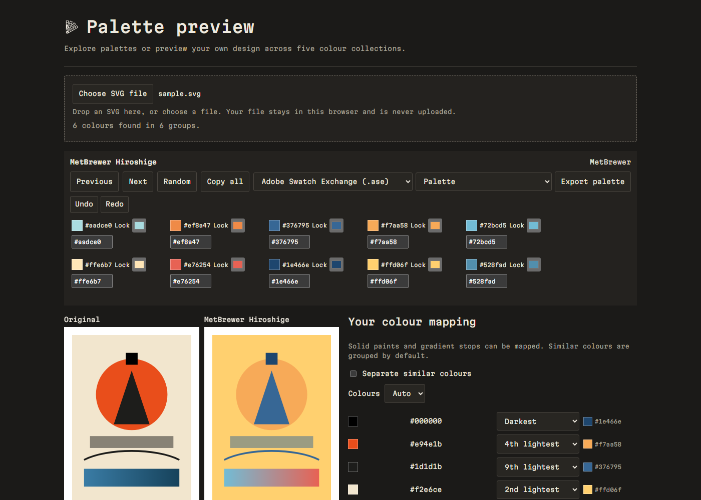

# Palette Preview

[](https://github.com/morp1e/palette-preview/actions/workflows/ci.yml) [](LICENSE) [](https://morpeia.com/palette/)

Preview your own SVG artwork in 2,125 curated colour palettes, in the browser.

[Use it](#use-it) · [What it does](#what-it-does) · [Export](#export) · [Palettes](#palettes) · [How it works](#how-it-works) · [Run locally](#run-locally) · [Licences](#licences)

## Use it

[Open Palette Preview](https://morpeia.com/palette/). Nothing to install.

## What it does

- Recolours flat SVG paint: fills, strokes, and gradient stops.
- Groups similar colours and limits the working set to 2 to 6 colours.
- Lock and edit colours, compare up to 8 palettes, and undo changes.



## Export

- `.ase` for Illustrator, InDesign, Photoshop, and Procreate imports.
- `.swatches` for Procreate.
- `.gpl` for GIMP, Inkscape, and Krita.
- CSS custom properties, a swatch sheet PNG, recoloured SVG, and PNG.

## Palettes

| Source | Count | Licence | Link |
|---|---:|---|---|
| Sanzo Wada via mattdesl | 348 | MIT | [Dictionary of Colour Combinations](https://github.com/mattdesl/dictionary-of-colour-combinations) |
| MetBrewer | 56 | CC0 | [MetBrewer](https://github.com/BlakeRMills/MetBrewer) |
| Wes Anderson palettes | 22 | MIT | [wesanderson](https://github.com/karthik/wesanderson) |
| ColourLovers via nice-color-palettes | 992 | MIT wrapper; individual palettes carry ColourLovers' own terms | [nice-color-palettes](https://github.com/Experience-Monks/nice-color-palettes) |
| Color Hunt | 707 | Palettes described by Color Hunt as public property; snapshot of public feeds, 2026-10-20 | [Color Hunt](https://colorhunt.co/) |

## How it works

Your file never leaves the browser. SVG is sanitised and rendered as an isolated image. The page runs no script from the uploaded file, loads no external resources from it, and uploads nothing. The page's own code contains no analytics or tracking.

## The honest part

It does not recolour raster images or embedded bitmaps. Fonts not installed on the viewer's device render differently. CMYK and print colours are not simulated. Color Hunt and ColourLovers data are snapshots and may be removed if their owners ask.

## Alternatives

[Coolors Visualizer](https://coolors.co/visualizer) previews palettes on ready-made illustrations and on your own SVG; [Huemint](https://huemint.com/) generates colour systems with AI; [Adobe Color](https://color.adobe.com/) explores and extracts themes; [Lospec](https://lospec.com/palette-list) maintains a large pixel-art palette list.

## Run locally

Node 22 or newer:

```sh
node tools/standalone.mjs && node tools/serve.mjs
```

Contributors can run `node --test tests/*.test.mjs` and rebuild the palette data with `node tools/build-palette-data.mjs`.

## Licences

The code is MIT. Data and font licences are described in [NOTICE.md](NOTICE.md) and included beside their source files.
